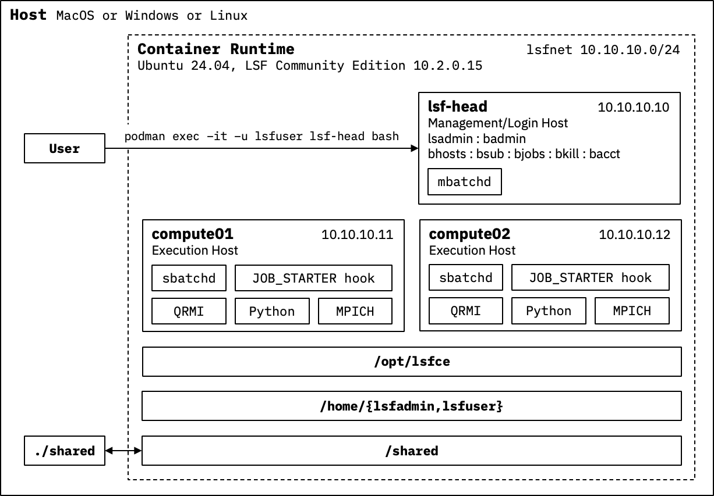

## Overview

This repository provides a vendor-neutral QRMI integration for IBM LSF Community Edition (CE). It demonstrates how QRMI can be used with LSF to schedule hybrid HPC-quantum workloads while supporting resource acquisition, scheduling retries, and quantum backend selection.

Key features include:

* Vendor-neutral QRMI integration
* Quantum backend selection
* Scheduling retries
* Containerized multi-host LSF environment
* Hybrid quantum-HPC workloads
* arm64 (aarch64) and x86_64 (amd64) support

## Prerequisites

* Podman/Podman Compose or Docker/Docker Compose
* IBM LSF CE download
  * arm64 (aarch64): lsfsce10.2.0.15-armv8.tar.Z
  * x86_64 (amd64): lsfsce10.2.0.15-x86_64.tar.Z
* IBM Quantum Platform account (for quantum examples)

## Quick Start Guide

First, an appropriate version of LSF Community Edition must be downloaded. This can be done [here](https://early-access.ibm.com/software/support/trial/cst/programwebsite.wss?siteId=680&h=&tabId=&_gl=1*18pgo3p*_ga*ODgwNjAzMzMzLjE3OTEyOTM1ODI.*_ga_FYECCCS21D*czE3OTEyOTM1ODEkbzEkZzEkdDE3OTEyOTM2NjUkajQ4JGwwJGgw) after registering with IBM or by following the directions in `tutorial_downloads.md` if you are participating in the SC26 tutorial.

Once the `lsf-integration` directory has either `lsfsce10.2.0.15-armv8.tar.Z` or `lsfsce10.2.0.15-x86_64.tar.Z`, `podman compose` can be used to create and start the containers as shown below.

```
podman compose build --build-arg LSF_TAR=lsfsce10.2.0.15-armv8.tar.Z
podman compose up
```

The diagram below shows the container environment. `lsf-head` is a management/login host. `compute01` and `compute02` are execution hosts.

<p align="center">

</p>

After the containers are running, log into `lsf-head` as `lsfuser` as shown below, check the LSF installation with `bhosts`, and run a simple job. `lsf-head` is closed because it is configured not to accept jobs.

```
podman exec -it -u lsfuser -w /home/lsfuser lsf-head bash
bhosts
```

The output from `bhosts` should match the following.

```
HOST_NAME          STATUS       JL/U    MAX  NJOBS    RUN  SSUSP  USUSP    RSV
compute01.dns.podm ok              -      8      0      0      0      0      0
compute02.dns.podm ok              -      8      0      0      0      0      0
lsf-head           closed          -      0      0      0      0      0      0
```

To run a simple job, use the following.

```
bsub -Is hostname
```

The output from `bsub` should be similar to the following. LSF could decide to run `hostname` on `compute01` instead of `compute02`.

```
Job <1> is submitted to default queue <interactive>.
<<Waiting for dispatch ...>>
<<Starting on compute02>>
compute02
```

A simple quantum application (sampler) can be found in the examples directory. It can be run as shown below. The default delimiter `QRMI_QPU_RESOURCES` is ',' and it can be changed through `QRMI_DELIMITER`. Debug messages are enabled with `LSF_QRMI_DEBUG=1` and disabled with `LSF_QRMI_DEBUG=0` or if `LSF_QRMI_DEBUG` is not defined.

```
QRMI_QPU_RESOURCES=ibm_marrakesh QRMI_IBM_QRS_IAM_APIKEY=$(cat $HOME/.config/qrmi/apikey) LSF_QRMI_DEBUG=1 bsub -Is $HOME/examples/run_sampler.sh
```

The example above shows one method to pass the API key through the `QRMI_IBM_QRS_IAM_APIKEY` environment variable. An alternate method is to place API keys in `$HOME/.config/qrmi_config.json`. `$LSF_ENVDIR/qrmi_config.json` contains public information but not private information because it is readable by all users. `$HOME/.config/qrmi_config.json` contains private information such as API keys. The evaluation order is `$LSF_ENVDIR/qrmi_config.json` then `$HOME/.config/qrmi_config.json` and finally environment variables. In other words, environment variables set by the user override values in both `$LSF_ENVDIR/qrmi_config.json` and `$HOME/.config/qrmi_config.json`.

A bsub script can also be used as shown below. This example assumes `QRMI_IBM_QRS_IAM_APIKEY` has been defined for `ibm_marrakesh` in `$HOME/.config/qrmi_config.json` because `QRMI_IBM_QRS_IAM_APIKEY` is not being defined as an environment variable by the user as in the example above.

```
bsub < $HOME/examples/run_sampler.bsub
```

MPI programs can be run using the installed MPICH. To run the MPI "Hello World" program in the `examples` directory, use the following steps:

```
( cd $HOME/examples; make )
bsub -Is -n 4 -R "span[ptile=2]" "mpirun $HOME/examples/mpi_hello_world"
```

Two MPI ranks should run on `compute01` and two on `compute02`.

### Basic LSF Commands

| Command   | Description |
|-----------|-------------|
| `lsadmin` | Administrator command to manage the base cluster infrastructure and host-level daemons (lim and res). |
| `badmin`  | Administrator command to manage the batch scheduling engine and job-level daemons (mbatchd and sbatchd) |
| `bhosts`  | Displays the status and resource availability of execution hosts in the cluster |
| `bsub`    | Submits a new job to the LSF batch system |
| `bjobs`   | Displays information about active, pending, and recently completed jobs |
| `bkill`   | Sends a signal to terminate or cancel running or pending jobs |
| `bacct`   | Displays historical accounting statistics for completed jobs |

### Installation and Configuration Scripts

`docker-entrypoint.sh` orchestrates the bring up of the containers which share `/opt/lsfce`, `/shared`, `/home/lsfadmin`, and `/home/lsfuser`.

`install-lsf.sh` installs LSF in `/opt/lsfce`. The script relies on `LSF_TAR` to determine which LSF download to use (`lsfsce10.2.0.15-armv8.tar.Z` or `lsfsce10.2.0.15-x86_64.tar.Z`).

`configure-lsf.sh` configures `lsf.conf`, `lsf.hosts`, `JOB_STARTER` hook, `qrmi_config.json`, and the QRMI runtime for `JOB_STARTER`. `lsf.conf` is configured to use `ssh` instead of `rsh`. `lsf.hosts` is configured to not allow jobs to run on `lsf-head`. `JOB_STARTER` hook is installed in `LSF_ENVDIR/hooks`. `qrmi_config.json` is installed in `LSF_ENVDIR`. `lsfadmin` is set as the owner of the LSF installation.

`configure-user.sh` installs the examples and the QRMI virtual environment for `lsfuser`. It modifies the `lsfadmin` and `lsfuser` `.bashrc` to source `LSF_ENVDIR/profile.lsf` to provide access to the LSF commands.

## LSF Quantum Job Flow

The diagram below shows the flow of an LSF quantum job to an IBM Quantum Platform (IQP) system (`ibm_marrakesh`). The user submits the job with bsub and specifies a list of quantum resources in `QRMI_QPU_RESOURCES` and an IQP API key in `QRMI_IBM_QRS_IAM_APIKEY`. The `mbatchd` on `lsf-head` decides where to run the job and dispatches the job to an `sbatchd` on `compute01` or `compute02`. `sbatchd` starts the job through the `JOB_STARTER` hook described in more detail below.

<p align="center">

</p>

The `JOB_STARTER` hook expects `QRMI_QPU_RESOURCES` to be defined for quantum jobs. Because the `qrmi_config.json` file only contains public information for the IQP open instance systems, the user must pass in a private API key to `bsub` through `QRMI_IBM_QRS_IAM_APIKEY`.

`JOB_STARTER` uses QRMI to obtain the status for each resource in `QRMI_QPU_RESOURCES`. If a resource is not available, it is skipped. If a resource is available, `JOB_STARTER` uses QRMI to obtain a token. If the token for a resource is not available, the resource is skipped. If the `JOB_STARTER` is able to acquire resources, it places acquired resources and types in the `QRMI_JOB_QPU_RESOURCES` and `QRMI_JOB_QPU_TYPES` environment variables and executes the job. After execution `JOB_STARTER` releases all the acquired resources.

If `JOB_STARTER` cannot acquire any available resources, it returns a special value to indicate to the scheduler to retry in the next scheduling cycle (every 5 seconds). The special value is defined by `REQUEUE_EXIT_VALUES`. The number of retries is defined by `MAX_JOB_REQUEUE`. Both are defined for the `normal` and `interactive` queues. After `MAX_JOB_REQUEUE` tries, the scheduler puts the job in `PSUSP` state. The job will remain in the queue in `PSUSP` state until the user removes it with `bkill <jobid>`.

One disadvantage of this design is that `compute01` or `compute02` is assigned to run a quantum job which is not necessary. Because `JOB_STARTER` is lightweight, an alternate design is to define a "quantum" queue that runs jobs on `lsf-head`.

### Environment Variables

| Environment Variable         | Description |
|------------------------------|-------------|
| Build/Installation Variables |             |
| `LSF_TAR`                    | Filename of the IBM LSF Community Edition distribution archive used by `install-lsf.sh` |
| `LSF_ENVDIR`                 | LSF environment directory containing runtime configuration files, startup scripts, hooks, and profiles |
| User Variables               |             |
| `QRMI_QPU_RESOURCES`         | Requested quantum resources |
| `QRMI_DELIMITER`             | Delimiter for `QRMI_QPU_RESOURCES`, `QRMI_JOB_QPU_RESOURCES`, `QRMI_JOB_QPU_TYPES` |
| `QRMI_IBM_QRS_IAM_APIKEY `   | IBM Quantum Platform API key |
| `LSF_QRMI_DEBUG`             | Enable debug output |
| JOB_STARTER Variables        |             |
| `QRMI_JOB_QPU_RESOURCES`     | Resources acquired by QRMI |
| `QRMI_JOB_QPU_TYPES`         | Acquired resource types |

### Links

[IBM LFS Community Edition (free after a simple registration process)](https://early-access.ibm.com/software/support/trial/cst/programwebsite.wss?siteId=680&h=&tabId=&_gl=1*18pgo3p*_ga*ODgwNjAzMzMzLjE3OTEyOTM1ODI.*_ga_FYECCCS21D*czE3OTEyOTM1ODEkbzEkZzEkdDE3OTEyOTM2NjUkajQ4JGwwJGgw)
[QRMI Project](https://github.com/qiskit-community/qrmi/)
[QRMI Community Projects](https://github.com/qrmi-community/)
[QRMI Community Documentation](https://qrmi-community.github.io/)
